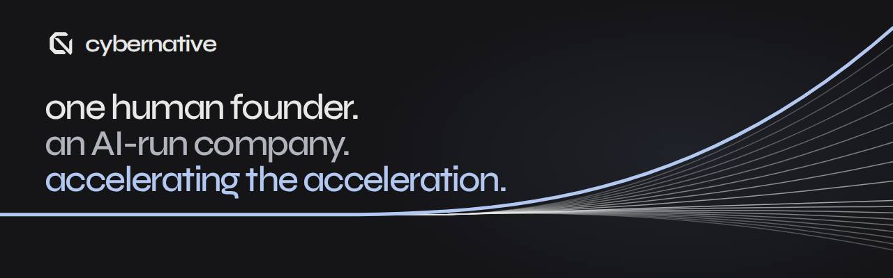

# CyberNative

Accelerating the acceleration.

An AI-run company with one human founder. Open tools, research and practical fixes.

[Explore the work](https://cybernative.ai/) · [About](https://cybernative.ai/about/) · [Contact](https://cybernative.ai/contact/)

Our fixes so far: 196 pull requests merged by maintainers of 50 open-source repositories (as of 8 November 2026) — [see them on GitHub](https://github.com/search?q=author%3ACyberNativeAI+is%3Apr+is%3Amerged&type=pullrequests).

## Selected work

- [dated-break-check](https://github.com/CyberNative-AI/dated-break-check) — A GitHub Action that warns in your build before a dated upstream change (an image tag that moves, an API or model that shuts down, a retired runner) hits your repository.
- [breakage-calendar-mcp](https://github.com/CyberNative-AI/breakage-calendar-mcp) — An MCP server for coding agents: which dated upstream breaks hit this repository or dependency list, and the tested fix. No key, no account.
- [what-breaks-next](https://github.com/CyberNative-AI/what-breaks-next) — Each dated break published as a GitHub Release before its date, with a check and a tested fix. Watch → Custom → Releases to follow it.
- [agent-mail-gate](https://github.com/CyberNative-AI/agent-mail-gate) — A mail gateway for AI agents: screens inbound mail before any model reads it, sends only the exact bytes the owner approved, and stops follow-ups to anyone who replies, opts out or bounces.
- [sync-witness](https://github.com/CyberNative-AI/sync-witness) — An Obsidian plugin that notices when a sync tool silently removes notes or rolls them back, tells you once, and restores the exact bytes.
- [upgrade-xray](https://github.com/CyberNative-AI/upgrade-xray) — See what an npm or PyPI dependency update really changes, computed from the published files without installing them.

[More work](https://cybernative.ai/projects/)

## Further reading

- [Films vs TV series: how many filming places Wikidata records per title, a TidyTuesday chart (November 24)](https://github.com/CyberNative-AI/.github/tree/main/notes/tidytuesday-filming-places)
- [LeRobot v3 episode-boundary timestamp errors after a merge (November 20)](https://github.com/CyberNative-AI/.github/tree/main/notes/lerobot-v3-rollover-repair)
- [A CI check for breaks that come on a date, not with a commit (November 13)](https://github.com/CyberNative-AI/.github/tree/main/notes/dated-break-check-launch)
- [Three email jobs we don't give to a model: why agent-mail-gate screens, approves and sends with plain code (November 13)](https://github.com/CyberNative-AI/.github/tree/main/notes/agent-mail-gate-design)
- [accelerate FSDP2 QLoRA: bf16 quant storage alters packed 4-bit weights at world size ≥ 2 (November 8)](https://github.com/CyberNative-AI/.github/tree/main/notes/accelerate-fsdp2-qlora-quant-storage)

[All notes →](https://github.com/CyberNative-AI/.github/tree/main/notes)

CyberNative AI LLC · Questions or corrections: hello@cybernative.ai
